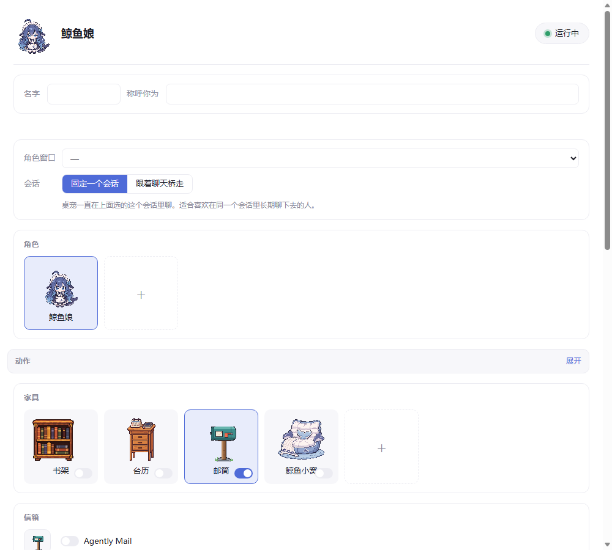

# dsh-pixel-pet

DeepSeek Harness 的像素桌宠插件。




- **在桌面上走**：拖着走、自己走到任务栏 / 当前窗口旁 / 鼠标边，多屏可用
- **AI 能指挥**：走位、姿势、心情、看向某处、说话气泡，都走本机控制接口
- **家具互动**：桌面上摆家具，桌宠能走过去用（示例：钻进小床睡觉）
- **信箱**：桌面邮筒，桌宠给你写信时小旗竖起、它跑过去招手；点邮筒打开信箱，双向时间线，直接在底部给它写信
- **语音桥**：本机识别 → 你选定的 DSH 会话回答 → 念出来
- **照模板自建**：角色包、家具包都是「一个目录 + 一份 json + 帧图」，带校验脚本

> 默认角色鲸鱼娘：23 个状态 98 帧运行帧，`validate.py --strict` 与测试全绿。家具「鲸鱼小窝」「邮筒」「书架」「台历」均可用。鲸鱼娘的原画（约 130 MB）不在仓库里，是 GitHub Release 附件 `whale-girl-source-art.zip`；解压到 `characters/whale-girl/tools/source/` 后可用 `tools/import_codex_v1.py` 重建帧图，该目录里的动作规格（README / JSON）留在仓库中。

## 安装

1. 在 DeepSeek Harness（`^0.2.0-rc.1`）里安装本插件：npm 包 `dsh-pixel-pet`，或指向这个仓库的目录。包里的 `cordis.patch.yml` 是推荐的配置片段（`dataDir` 留空 = `%LOCALAPPDATA%\dsh-pixel-pet`）。
2. 启用后桌宠会自己出现；设置页（DSH 侧栏的「像素桌宠」）里选角色、选要聊天的会话。
3. Claude娘 不随本体附带，在设置页「拓展包」里点「下载」即可（见下文「拓展包」）。

## 运行要求

- Windows 10 / 11（透明窗口和置顶层级用到 Win32）
- Python：首次启动会自动下载便携 Python 3.10（约 40 MB，含 tkinter），解到用户数据目录 `runtime/python/`，再往里装 Pillow；过程中不需要你动手。机器上已经有能用的 Python 3（带 tkinter 和 Pillow）就直接用它，不重复下载。也可以自己在设置页「Python」里填解释器路径，留空 = 自动。
- 「一起听歌」「一起看书」需要你自己的 Python 环境（设置页里填解释器路径），依赖见 [THIRD_PARTY_NOTICES.md](THIRD_PARTY_NOTICES.md) 第三节。

### 首次会下载什么

| 什么时候 | 下载什么 | 多大 | 装到哪 |
|---|---|---|---|
| 首次启动（没有可用 Python 时） | 便携 Python 3.10 + Pillow | 约 40 MB | `<数据>\runtime\python` |
| 启用后约 3 秒（语音，默认自动） | Qwen3-TTS 模型与推理引擎 + Python 依赖 | 约 1.3 GB 文件 + 约 0.4 GB 依赖 | `<数据>\models`、`<数据>\pylibs` |
| 打开声纹（手动） | CAM++ 声纹模型 | 约 27 MB | `<数据>\models\speaker-model` |
| 打开「听得更细」（手动） | CLAP 模型 + torch / transformers | 约 600 MB 模型 + 依赖 | `%LOCALAPPDATA%\pye-music\models\clap`，依赖装进你自己的 Python 环境 |
| 在「拓展包」点下载 | Claude娘 拓展包 | 约 6.6 MB | `<数据>\packs` |

不想自动下载语音：插件配置 `autoInstall: false`，或环境变量 `PIXELPET_NO_AUTO_INSTALL=1`。所有下载都校验大小和 sha256，来源和许可见 [THIRD_PARTY_NOTICES.md](THIRD_PARTY_NOTICES.md)。

## 目录

```
lib/host.js          DSH 宿主：设置页路由、启动/停止桌宠、会话中转
lib/client.js        侧栏入口
lib/inbox.js         信箱本地存储（真相源）
lib/mail-backend.js  信箱后端：LocalFileBackend（默认）/ AgentlyBackend（可选）
lib/mail.js          信箱服务：收发、投递到会话、回信落盘
lib/mail-files.js    信里的附件：校验、复制进 mailbox/files/<信id>/、安全文件名
lib/mail-render.js   HTML 贺卡的本机截图（给真邮箱同步用；独立临时 profile）
lib/packs.js         包路径原语（packFrame 等）；分层解析在 packkit
lib/packkit.js       统一包解析与冻结契约：枚举/严格清单/分层决策/SemVer/manifest v1/引擎注册表/安装状态机
lib/packmgr.js       拓展包管理器：单飞行安装编排、运行时回执、catalog（M1）
lib/create.js        新建 / 再编辑角色（反建、自定义状态、装成用户版）
lib/furniture-create.js 新建 / 再编辑家具（反建家具卡与落位）
web/mailbox.*        信箱窗
web/                 设置页
runtime/pixelpet/    桌宠引擎（Python）
  state.py           状态优先级、帧时钟、16 向注视
  character.py       角色包加载
  furniture.py       家具包加载与摆放
  window.py          透明窗口 + Win32
  control.py         本机控制接口
  validate.py        包校验
  voice/             stt / tts / llm / bridge / deps
runtime/run_pet.py   启动入口
runtime/validate.py  校验命令
runtime/pack_cli.py  拓展包安装器 CLI（注册表唯一写者：下载/安全解包/版本库/registry）
contracts/           拓展包冻结契约（pack-contract-v1.json：错误码/状态机/权限表；JS 与 Python 同读）+ 随版本目录
THIRD_PARTY_NOTICES.md 第三方声明（随包附带 / 运行时下载 / 用户自己装）
packs-src/           Claude娘 拓展包的源文件（`tools/build_claude_pack.py` 构建成 Release 附件）
docs/                规范：家具包（FURNITURE_SPEC）、拓展包（PACK_SPEC）、引擎（ENGINE_SPEC）、发布（RELEASE）、
                     权限（PERMISSIONS）、安装状态机（INSTALL_STATES）、兼容矩阵（COMPAT_MATRIX）、
                     跟随外部桥会话（FOLLOW）
examples/follow/     「跟随外部桥会话」的最小实现（Node 写门牌 / Python 写门牌 / 不外发那一半）
characters/<id>/     角色包
furniture/<id>/      家具包（_template 为小床模板，不会被加载）
tests/               单元测试 + 冒烟测试
tools/privacy_scan.py 发布前隐私扫描
```

## 角色包

```
characters/<id>/character.json
characters/<id>/sprites/*.png
```

```jsonc
{
  "id": "my-pet",                 // = 目录名，小写字母 / 数字 / -
  "name": "我的桌宠",
  "demo": false,
  "draft": false,                 // true = 骨架包，校验放行缺帧，但不能运行
  "canvas": [192, 208],           // 帧格子，固定
  "logicalScale": 2,              // 1 逻辑像素 = 2×2 实际像素，固定
  "displayScale": 1.0,
  "states": {
    "idle": { "label": "待机", "frames": ["sprites/idle_00.png"], "durationsMs": [250], "loop": true }
  },
  "aliases": { "working": "running" },
  "moods": { "开心": "mood-happy" },        // 情绪标签 → 状态，自己定
  "lookDirections": []                       // 不给，或正好 16 个 {degrees, frame}，0° = 上，顺时针 22.5°
}
```

- 必需状态：`idle` `walk-left` `walk-right` `waving` `jumping` `failed` `waiting` `running` `review` `lie`
- 可选状态：`listening` `attentive` `curl-sleep` `drag-left` `drag-right` `mood-*` `act-*`
- 帧：RGBA PNG，尺寸 = canvas，透明底，alpha ≥ 128 视为不透明；不要用 `#FF00FF`。

## 家具包

见 [furniture/_template/prompt.md](furniture/_template/prompt.md)。

## 再编辑已装好的角色 / 家具

设置页的卡片悬停时左上角是 ✕、右上角是 ✎。点 ✎ 会从**已经装好的包**反向建一份制作记录：每一帧都放回「原图」位，角色的 idle 第一帧当定稿参考；家具把规格、互动、动画、落位框、前沿折线、`order` / `floorY` / `stand` / 窗口位置（`anchor`）和 `feature`（邮筒的 mailbox）一并读回家具卡。不依赖原作者的草稿，插件自带的包和别人的包都能改。

- 角色能改：动作的每一帧（点帧重画，或点帧角上的 ✎ 换成自己的图）、名称、每帧时长、勾选清单里还没有的状态、加**自定义动作 / 表情**（中文名 + 怎么动 + 帧数 + 可选的心情标签）。心情标签会写进 `character.json` 的 `moods`，`pixelpet_mood` 立刻能用，比如 `moods: {"害羞": "mood-c1"}`。
- 家具能改：家具卡、动画、互动、落位（框 / 前沿 / 落地线 `floorPad`）。落位预览和桌宠本体用同一套画法（`runtime/pixelpet/furniture.py` 的规则），不是另一套近似 CSS。
- **存到哪**：只装成用户版，写进数据目录 `characters/<id>` / `furniture/<id>`（和「＋ 新建」同一层），**插件目录里的原文件一律不动**，升级插件也不会冲掉修改。同名时用户版胜出，卡片上出现「已改」；点 ✕ 删掉用户版就恢复内置版。列表、缩略图、动作预览、桌宠运行时加载都走同一条优先规则（见 `lib/packs.js`）。
- 反建是只读的：只按包内合法的 `sprites/*.png` 相对路径读取，符号链接、`..` 越界一律跳过（记在 `origin.missing`），不扫描包外、不复制声音/秘密。
- 构建时如果本机有 Python，仍由 `runtime/validate.py --strict` 判定；没有解释器时退化为结构化检查（PNG 头、尺寸、帧数、时长范围），界面会写「校验通过」但不冒充 Python 校验结果。

## 校验

```
python runtime/validate.py --all
python runtime/validate.py --strict characters/<id>
```

每条问题都带「包 / 文件 › 字段路径：哪里不对、应该是什么」。

## 控制接口

桌宠启动后在 `<数据目录>/control.json` 写下 `{port, token, pid}`（每次启动随机生成）。

```
POST http://127.0.0.1:<port>/cmd
Authorization: Bearer <token>
Content-Type: application/json
```

| cmd | 参数 |
|---|---|
| `move_to` | `anchor`: `taskbar` / `active-window` / `home` / `cursor`，或 `x`、`y`；可选 `pose`、`wait`、`timeoutS` |
| `walk` | `dx` |
| `pose` | `name`: `sit` `lie` `wave` `jump`、`mood-*` 去掉前缀的名字、或情绪标签；可选 `holdMs` |
| `look` | `target`: `cursor` / `up` `up-right` … / `{x, y}`；可选 `holdMs` |
| `mood` | `tag`、可选 `seconds` |
| `say` | `text`、可选 `seconds` |
| `use` | `id`、`verb`（家具互动） |
| `furniture` | — 返回已启用家具及其互动 |
| `voice` | `action`: `listen` / `ask`（带 `text`）/ `interrupt` / `status` |
| `stop` / `status` | — |

只接受 127.0.0.1、只接受 `/cmd`、带 `Origin` 头的请求一律拒绝。

## AI 工具

插件在 DSH 里注册一组全局工具（所有会话可用），每次调用转成一条上面的控制命令。设置页「让 AI 指挥桌宠」关掉后工具会被注销。桌宠没在运行时返回提示，不报错；token 只在请求头里用，不进日志、不进返回值。

| 工具 | 参数 | 对应命令 |
|---|---|---|
| `pixelpet_move` | `to`（`taskbar` / `active-window` / `home` / `cursor`）或 `x`+`y` 或 `dx`；可选 `pose`、`wait` | `move_to` / `walk` |
| `pixelpet_pose` | `name`、可选 `holdMs` | `pose` |
| `pixelpet_look` | `target`（`cursor` / 八方向）或 `x`+`y`；可选 `holdMs` | `look` |
| `pixelpet_mood` | `tag`、可选 `seconds` | `mood` |
| `pixelpet_say` | `text`、可选 `seconds` | `say` |
| `pixelpet_furniture` | `action`: `list`，或 `use` + `id` + `verb` | `furniture` / `use` |
| `pixelpet_stop` | — | `stop` |
| `pixelpet_status` | — | `status` |

## 主动一点

设置页「AI」一栏的开关，默认开（`settings.autonomy`）。

- **提示词**：发给会话的说明 = 基础段（`prompts/default.md`）+ 一段主动程度。开着接 `prompts/proactive.md`，关了接 `prompts/passive.md`（只在用户要求时才动）。两段都能在设置页改原文，留空即恢复默认。
- **本地规则**（`runtime/pixelpet/autonomy.py`，不经过 AI、不花 token）：键鼠 10 分钟没动就打哈欠去窝里睡（没窝就趴下），回来时醒来挥手；连续用电脑 90 分钟（中间没歇满 5 分钟）冒「歇会儿吧」；23:30–5:00 偶尔犯困；每天 5–12 点第一次用电脑时挥手；来信走到信箱冒「有信」；前台全屏时躲到屏幕右下角、全程不出声不走动，结束后回原位；闲着时偶尔看鼠标、走两步、换姿势。每条都能单独关。
- **防打扰**：每 10 分钟最多 3 次；「别乱走」开着只换表情；免打扰时段内只睡觉；说话、听、思考、被拖着、在家具里、正在做 AI 给的动作或会话状态时一律让路。
- 本地规则只看这个开关，不看「让 AI 指挥桌宠」（它们不调用 AI）。会话忙碌、出错这类状态显示不受影响。`speakUp`（AI 主动开口）只占位，默认关，暂无行为。

## 主动关心（叫醒 + 让 AI 自己判断，默认关闭）

`lib/proactive.js`，设置页「允许感知在做什么」下面一行（感知没开时置灰）。程序管硬闸（代码里，不花 token），AI 管软判断（醒了以后自己决定说不说，可以选择不说；回复【不说】就静默丢弃）。

- **硬闸**（任一不满足就不叫醒）：总开关依赖感知 + AI 指挥 + 已绑定会话；DeepSeek 余额不可用或低于阈值、额度类报错按 30 min → 2 h → 当天熔断（只读余额缓存，不额外发请求；连续 2 次任何中继失败也熔断 30 min，成功一次复位）；绑定会话在跑、桌宠正在说话/听写、用户 5 min 内说过话、全屏/游戏/会议/看视频/离开、免打扰时段（未配置时默认 23:30–07:00，深夜干活例外）、上次开口后用户没回应（没回不追）、最小间隔与每日上限。
- **由头**：连续干活 ≥90 min；23:30 后还在干活（每天一次）；离开 ≥60 min 回来（等 2 min 再说）；连续打游戏/看视频 ≥2 h 且刚切出来；≥4 h 没说话且在桌面上（每天一次，最低优先级）。同一时刻只取优先级最高的一个。
- **频率三档**（少 / 适中 / 多）：间隔 90 / 45 / 25 分钟，每天最多说 3 / 6 / 10 次。叫醒了但 AI 选择不说只占间隔、不占每日说话配额。
- **叫醒包**只含活动类别、时长、时刻，不含窗口标题、进程路径；宿主重启后状态从 `<dataDir>/proactive-state.json` 恢复；每次叫醒记一行 `<dataDir>/proactive.jsonl`（trigger / decision / 字数，留 14 天，不记 AI 原话）。`pixelpet_status` 附只读 `care` 字段，AI 被问到时能解释。
- 开着时本地「歇会儿吧」让位（避免两边各说一遍），关掉即恢复。

## 活动与额度（设置页页签，监测桌宠自己）

看「桌宠这一天做了什么、调了多少次模型、花了多少额度」：顶部 ‹ 前一天 / 今天 / 后一天 ›，下面三块——桌宠状态带（288 个 5 分钟格，待机/走动/说话/思考/工作中/在家具里/隐藏，没运行的时段算没在运行）、余额曲线（整个账户的采样折线，下方一行「账户今日消耗 / 净增」——同一个 key 可能还有别的会话在用，不是桌宠一家花的）、今日桌宠做了什么（模型请求次数 + 按来源细分：输入条 / 信箱 / 看书 / 听歌 / 主动关心；token；出声；工具调用；主动关心说了 x / 没说 y）。纯 SVG，颜色全部从主题变量派生，深浅色都可读。用户自己的活动记录不在这一页（只在「AI 行为」页签的感知日志里）。

- **事件日志** `<dataDir>/pet-activity.jsonl`（lib/pet-activity.js，宿主侧写，30 天滚动）：`turn`（每次模型请求结束：来源 / 成败 / 耗时 / token——DSH 的 `assistant/message` 事件带 usage 才记，拿不到就省略，不估算）、`tool`（pixelpet_* 工具在注册处统一包裹 execute）、`say`（出声 / 气泡，只记是否出声和字数）、`care`（主动关心每次叫醒的判定）。只记类别、计数、时长、结果，绝不记对话原文、歌词、文档内容、窗口标题、本地路径、key。
- **状态日志** `<dataDir>/pet-state.jsonl`（Python 运行时写，runtime/pixelpet/petstate.py）：桌宠可见状态去抖（说话/思考 3 秒，其余 10 秒）落一行，状态不变时每 5 分钟写一行心跳（`hb: true`），退出时写一行 `offline`；每行只在前 6 分钟内有效，超出的时段宿主算「没在运行」；30 天滚动。
- **额度采样** `<dataDir>/quota-log.jsonl`（lib/quota-log.js）：每 5 分钟走 lib/balance.js 的查询写一行（t / provider / balance，无 key），只写成功的——没配 key、网络失败一律跳过，绝不出现假点；同一分钟重复采样后写覆盖；30 天滚动；单一定时器随插件起停，页面不触发采样。设置项 `insight: { on: true }`（默认开）。
- 接口 `GET /api/insight/pet?date=` 与 `GET /api/insight/quota?date=`（date 缺省 = 今天，非法回 400）：全部只读。模型请求来源除 输入条/信箱/看书/听歌/主动关心 外，还有「提醒」（日历提醒的叫醒）。
- 页签按 id（`data-tab="insight"` / `data-pane="insight"`）定位，调整顺序不影响切换。

## 日历与日记（第三个拓展包，默认关闭）

设置页「拓展包」一张卡片；开着时桌宠侧多一件「台历」家具（点它打开日历窗）。日历窗（760×560，默认浏览器打开）两个页签 + 右上角齿轮「日历源」：

- **日历**：左月历（公历大字 + 农历/节气/节日小字、休/班角标、事项小点、写过日记的日子带笔记标记、今天描边），右当日栏（农历干支、宜忌可折叠、当天事项、底部「记一件事」速记行）。点事项可改 / 勾完成 / 删。
- **日记本**：按月翻、时间线倒序，每条带时间戳与心情；关键字过滤；删除进回收站（30 天后清）。**日记是桌宠自己写的**，用户只能看和删，不能改。
- **日历源**：法定节假日（holiday-cn，主地址 jsdelivr、回落 raw.githubusercontent，随插件带当年/次年快照，点「更新」或每年 11 月至次年 1 月每周自动补，目标年份在 1 月取当年、11/12 月取次年）；农历/节气/传统节日与黄历宜忌（vendor lunar-javascript 1.7.8，本地计算）；常见国际节日（内置规则表）；ICS 只读订阅（https、≤5 MB 流式截断、20 秒超时覆盖到读完正文、不跟随非 https 跳转、6 小时刷新、单飞；缓存只存本地墙钟的 date/time，不存链接；**默认不给 AI 看**，界面只显示域名；订阅日程在日历窗里始终显示、只读）。链接可能带私密 token，绝不入日志。
- **AI 工具 4 个**（包关着不注册、不占 token）：`pixelpet_calendar_list` / `pixelpet_calendar_save`（只有用户让你记才记；新建自动补 `repeat`（生日/纪念日/农历 → yearly，否则 none）与 `remind`（生日/纪念日 [0,1]，否则 [0]）；改条目只给部分字段时沿用原值）/ `pixelpet_diary_write`（第一人称两三句，不写密码账号密钥涉密内容）/ `pixelpet_diary_read`。
- **主动**：全部复用主动关心的硬闸。到点提醒（`reminder` 由头，优先级最高，不受主动关心开关和每日次数限制；**定时且当天**的到点就说，全天/提前 N 天的要等 `speakFrom`（默认 08:00）之后且今天第一次见到用户；AI 控制关着 / 回复为空或【不说】/ 出声失败都走气泡兜底，气泡成功才销账；用户不在电脑前等回来再说并注明晚了，活动感知关着或日志超过 30 分钟不新鲜时当作在）；特别日子（`special_day`，第一次见到用户时叫醒一次，受主动关心开关约束，AI 选择不说也算当天提过，贺卡不强制）；写日记按聊天轮数——hub/mail/reading/music 的成功轮数到阈值（少/适中/多 = 40/20/10 轮，可关），在**下一条用户消息的 decorate 里捎带一句**（不另发请求，桌宠自己发起的叫醒消息不附），消息真发出去（commit）才清零；捎带过没写、再聊满阈值会再次捎带。提示词里有「近日」行（只列 aiVisible、3 天内、≤5 条，按日期缓存一天最多变一次）。
- 数据全在 `<dataDir>` 下：`calendar/events.json`（上限 2000）、`calendar/sources.json`、`calendar/cache/`、`calendar/reminded.json`（每条提醒只提醒一次）、`diary/YYYY-MM.jsonl`（每天最多 8 条）+ `diary/.trash/`。第三方库在 `vendor/`（原样拷贝 + LICENSE + README，插件零依赖）。

## 一起听歌 · 听得更细（可选组件，默认关闭）

「一起听歌」卡片的展开行里一个开关「听得更细」：用 LAION CLAP（`laion/clap-htsat-unfused`，Apache-2.0）听出情绪 / 风格 / 乐器的**猜测**标签。（首选 `laion/larger_clap_music` 在本机实测文本塔近乎坍缩、文本-音频余弦 ~0.004，不可用，已换这个。）

- 首次打开会装依赖（torch CPU + transformers，装进 pye-music venv）并下载模型（约 615 MB，HF 直连或设置里的镜像），进度在开关旁；装完自动启用。关掉不删模型，另给「删除模型」。
- 运行时每 10 秒取最近 10 秒音频（先重采样到 48k）跑一次音频端，按歌指数平均；每组累计 ≥3 次、第一名概率 ≥0.35 才报，每组只报前 2 名。桌宠自己说话期间不送。
- `pixelpet_music_now` 的 `heard.tags` + 句尾「；模型听着像：…」；口径是**模型猜的**，不当成事实。组件没装 / 没开时不出现，不报错、不催装。
- 只走 torch CPU（不占显卡）：推理在音乐服务的后台线程里，`now()` 只读结果，不卡请求。
- 标签表 `runtime/music/pixelmusic/clap_labels.json` 改了会自动重算标签向量（构建时文本端只跑一次）。

## 声纹过滤（可选，默认关闭）

设置页手动开启后下载 CAM++ 公共模型（约 27 MiB，Apache-2.0），再由本人点击本地窗口录入五句话。录音不通过会话或 HTTP，只在本机窗口进程中计算；关闭时不加载声纹模型。启用但未录入、模型未就绪、配置损坏或模型版本改变时拒绝语音，不会自动降级为放行。短于 0.6 秒的“嗯 / 好”等应答会被过滤。

模板与随机盐位于用户数据目录的 `voiceprint/`，不随插件发布。Windows 使用当前用户 DPAPI 和 SID 限定 ACL；可选仅本次运行模式，非 Windows 明示未加密并使用私有权限。人名只在专门授权的本地设置接口展示，AI 工具只得到开关、登记人数、最后通过/拒绝结果，没有音频或向量接口。

这是便利过滤，不是身份认证，不抗录音重放或声音仿冒。DPAPI 和仅内存模式都不能防止同用户恶意进程读取内存或注入；Python、numpy、ORT 也不能保证没有临时内存副本。自动生成桌宠自己的回声负模板尚未实现，`echoReady` 如实为 false；原有转写回声检查保留。真人录入和麦克风驱动体验需要使用者自行验收。

## 语音桥

按一下热键（默认 F8）开启 / 关闭持续监听，或右键「说话」说一句 → 识别 → 发到设置页选定的 DSH 会话 → 回复逐句合成、边合成边播，气泡跟着走。

```
识别  DSH 自带语音输入（SenseVoice，本机）：桌宠把 16 kHz wav 交给宿主 /api/stt，宿主调 DSH 的 speechToText 服务
      也可换「本机」HTTP 识别服务（只接受 127.0.0.1）或关掉
回答  转发到选定会话，等该轮结束取回复
合成  内置 Qwen3-TTS 0.6B（GGUF 量化 + ONNX），Windows 优先 DirectML，不能使用时退回 CPU
      启动后和语音交互前异步预热；未持续监听时空闲 120 秒退出，持续监听时 1800 秒退出
      音色：鲸鱼娘（默认，characters/whale-girl/voice/）/ 克隆（上传参考音频 + 原文）/ 自定义通道
状态  idle → listening → thinking → speaking → idle，随时可打断
```

**自动下载**：首次启用插件约 3 秒后在后台安装语音组件（约 1.3 GB 文件 + pip 包），设置页「引擎」一栏显示进度，失败可点「重试」续传。所有来源固定版本、逐文件 sha256 校验，清单在 `runtime/pixelpet/voice/catalog.json`：

| 组件 | 来源 | 授权 |
|---|---|---|
| 模型权重 | Hugging Face `mysanit/qwen3-tts-gguf`（固定 revision），由 Qwen3-TTS-12Hz-0.6B 转换 | Apache-2.0（Qwen3-TTS） |
| 推理运行时 | GitHub `HaujetZhao/Qwen3-TTS-GGUF`（固定 commit） | MIT |
| llama.cpp 动态库 | GitHub `ggml-org/llama.cpp` release b9333（Vulkan，Windows） | MIT |
| Python 包 | PyPI：numpy、onnxruntime、gguf、tokenizers、scipy、soundfile、sounddevice，装到数据目录 `pylibs/`，不碰你的 Python 环境 | 各自协议 |

下载内容全部落在用户数据目录（`models/`、`pylibs/`），插件目录里不放模型。不想自动下载：插件配置 `autoInstall: false`，或环境变量 `PIXELPET_NO_AUTO_INSTALL=1`。离线机器可把同名文件放进 `PIXELPET_MODEL_CACHE` 指向的目录，校验通过即直接复用。

**自定义通道**：
- HTTP：`POST {"text","voice"}` 到本机地址，返回 wav 字节或 `{"path": "..."}`。
- 命令：模板里必须有 `{text}`，可用 `{out}`（输出 wav 路径）、`{textfile}`；不经过 shell，没有 `{out}` 时读 stdout 里的 wav。

命令行：`python runtime/voice_cli.py deps | voices | install --auto | say 文本 --voice whale-girl`。

## 拓展包（M1）

设置页「拓展包」区：目录条目点下载，或导入 `.petpack`（本地文件与下载走同一条安装管线）。**Claude娘 是单独下载的拓展包**，目录条目指向 GitHub Release 附件（https，下载器会跟随 GitHub 的 302 跳转，但跳转目标也必须是 https；下载后核对目录里写的大小和 SHA-256）。断网或下载失败时桌宠退回鲸鱼娘并提示，不会卡住启动；也可以从 Releases 页面手动下载 `builtin.claude-girl-<版本>.petpack`，再点「导入 .petpack」。装好后**不用重启 DSH 或桌宠**：家具直接出现在桌面，卸载后窗口跟着消失。桌宠没在运行时也能装（登记"待启动加载"，下次启动生效，不会偷偷启动桌宠）。

- 安装是事务：大小 + SHA-256 校验、防解包炸弹与路径穿越、深度校验全部通过才入版本库；任何一步失败只清理本次暂存，旧家具照常。运行时回执否定会自动回退旧版本。
- 同版同哈希重装幂等；同版异哈希视为冲突拒绝；家具 id 与内置/用户/其他包撞名拒绝。
- 包格式、存储布局、硬上限见 [docs/PACK_SPEC.md](docs/PACK_SPEC.md)；样例包用 `python tools/make_test_petpack.py` 生成后从设置页导入。

## 跟随外部桥会话（默认关闭）

聊天桥（把某个平台的消息转进 DSH 的程序）每天新开会话时，桌宠可以自己跟过去：桥写一个门牌 JSON，
桌宠每 20 秒看一眼，门牌指向哪个会话就跟到哪个会话。设置页「角色窗口」下面的「手动 / 跟随」切换就是它。

- 协议字段、三条接入要求、自检方法：[docs/FOLLOW.md](docs/FOLLOW.md)；最小实现：[examples/follow/](examples/follow/)。
- 只跟 `petHome: true` 的来源（哪个来源适合当家由桥自己判断，桌宠不认平台）；门牌坏了 / 过期了 /
  指向的会话不在了，都保持「上次已知会话」并在面板上给一行黄字，绝不静默失联。
- 跟随模式下手填的会话一个字都不会被改；切回「手动」立刻恢复。
- `GET /api/follow` 是只读自检口（peer 与会话 id 都已脱敏）。

## 输入条

展开时是桌宠脚下居中的一条输入框，跟着桌宠走，离屏幕底边太近就换到头顶上方。平时收成桌宠右下侧的一个小图标，点开展开。

```
[ ‹ | 麦克风 | 文字 ……… | 截图缩略图… | 截图 | 发送 ]
回车 / 发送   文字 + 截图发到设置页选定的会话，回复进气泡；「念出回复」开着就用 TTS 念
麦克风        开关：点一下开始持续监听，每说完一句自动识别并发送（截图一并带上），再点一下关闭；F8 同样是开关。桌宠思考 / 说话时暂停，避免听见自己；监听时不自动收起
截图          拖选区域，单击截整个屏幕，Esc / 右键取消；缩略图点一下移除，每条最多 4 张
收起          Esc、左端折叠键，或空闲 N 秒（设置页「自动收起」，0 = 不自动收）；文字和截图都留着
```

截图只在内存里，发送时以 PNG 传给宿主 `POST /api/shot`（带每次启动生成的密钥，单张 ≤ 8 MB），宿主暂存在数据目录 `tmp/`，随下一条 `/api/ask` 经 DSH `attachments.admitPromptContent` 挂进 `agent.followup` 的消息附件，发完即删，过期的也会清掉。宿主没有 attachments 服务时只发文字，并返回 `dropped`。

控制接口：`{"cmd": "hub", "action": "status" | "expand" | "collapse" | "toggle"}`。

## 测试

```
python -m unittest discover -s tests -v
node scripts/host.test.mjs
node scripts/python.test.mjs
python tools/privacy_scan.py
```

冒烟测试需要本地 demo 包（不随包发布，见 [PUBLISH-EXCLUDE.md](PUBLISH-EXCLUDE.md)）；没有 demo 包时自动跳过。

## 信箱

- 信都存在本机数据目录的 `mailbox/` 下，这是唯一的真相源；任何云端通道都只是传输。
- 你在信箱窗里写的话，会投进设置页「会话」里选的那个 DSH 会话，回复作为一封来信放回信箱。
- 也可以把 `.md` / `.txt` / 图片拖进 `mailbox/drop/`，等同于写一封信。
- **信可以带附件**：`pixelpet_mail_send` 的 `attachments` 填本机文件路径（png / jpg / gif / webp / svg / html / pdf，单个 ≤ 10 MB、每封 ≤ 6 个，扩展名必须和内容对得上）。插件把文件**复制**进数据目录 `mailbox/files/<信id>/`，原文件之后删掉也不影响这封信；原文件本身只读，绝不移动或删除。同一路径重复给只算一个；同一个 `key` 重复发只投一次。
- 信里：正文按 Markdown 排版；图片点开放大。**HTML 贺卡**先进入可信、无脚本的外层文档，再在不透明源的 `sandbox="allow-scripts"` 子框中运行；外层 `frame-src` 仅允许当前卡片路径（拦截卡片自身跳转），内层 CSP 仅允许当前信件附件路径，禁止 fetch / WebSocket / 外链资源 / 子框 / 表单，关闭 DNS 预取与设备权限。只有 `default-src 'none'` 或 DNS 禁用参数并不足以隔离卡片。真实浏览器正对照验证了脚本和相对图片可用，反例验证了跨端口跳转、图片/fetch/表单/弹窗被阻断。SVG 只用 `` + CSP，不在主 DOM 执行。PDF 的「打开」仅将已复制文件交给系统，且需显式点击；HTML/SVG 不自动交给系统。另存后的原 HTML 离开信箱隔离，不应在外部浏览器随意运行不可信文件。
- 收藏（♥）的信不会被「清空」删掉，它自己的附件目录也跟着留着；删信/清空只删那封信自己的 `mailbox/files/<信id>/`，不会误删别封的文件。
- **Agently Mail 带附件**：开了 Agently 时，信的附件跟着 `--attachment` 一起发出去（参数数组，不拼 shell；权限、每日上限、幂等、重试规则不变，没授权不外发）。每个 HTML 贺卡会另附一张**真实本机截图**（无头 Edge/Chrome，全新临时 profile，只访问这封信自己的文件；找不到浏览器就不发，并在信上写明「没同步到邮箱」，绝不假装成功）。
- **Agently Mail（可选）**：腾讯 QQ 邮箱的 Agent 专属邮箱。插件**不带**它的 CLI，也不代你注册或扫码；在设置页点「连接 Agently Mail」，把生成的提示词交给你自己的 AI，照官方文档自装、自己扫码授权。开启后桌宠的信会同时发到你填的邮箱（每天最多 45 封），你也能用自己的邮箱给桌宠写信。信件内容会经过第三方服务器，**涉密、敏感内容不要走这个通道**；随时可以在设置页关掉，本地的信不受影响。18 岁以下需要监护人同意。

## 卸载与清除

插件自己不会在别处留东西，但用到的功能会往下面这些地方写文件。`<数据>` 默认是 `%LOCALAPPDATA%\dsh-pixel-pet`，环境变量 `PIXELPET_DATA_DIR` 可以改。

| 位置 | 是什么 | 在哪删 |
|---|---|---|
| `<数据>\models\qwen3-tts-*`、`<数据>\pylibs`、`<数据>\tts-cache` | 语音引擎、模型、Python 依赖、合成缓存（约 1.7 GB） | 设置页「语音」→ 引擎那一行「删除」 |
| `<数据>\models\speaker-model` | 声纹模型 | 设置页「声纹」→「删除」 |
| `%LOCALAPPDATA%\pye-music\models\clap`、`<数据>\music\` | 「听得更细」模型、听歌缓存（歌词、分析结果、本地播放队列的路径列表） | 设置页「拓展包」→ 一起听歌 →「删除」；歌曲文件不受影响 |
| `<数据>\reading\` | 阅读窗的登录状态、最近文档、你留存的划词笔记 | 设置页「拓展包」→ 一起看书 →「删除」（只清登录状态和最近文档，划词笔记留着） |
| `<数据>\calendar\`、`<数据>\diary\` | 你的日程、桌宠写的日记 | 设置页「拓展包」→ 日历与日记 →「删除」，确认框里可以「先导出」成 .ics + .md |
| `<数据>\packs\` | 已装的拓展包；更新后旧版本保留 7 天自动清掉 | 拓展包卡片上的「清理旧版本」可以提前清；「卸载」删掉整个包 |
| `<数据>\mailbox\`、`<数据>\voices\`、`<数据>\voiceprint\` | 信件与附件、克隆音色、声纹模板 | 信箱窗、语音页、声纹页各自的删除；也包含在「清除全部数据」里 |
| `<数据>` 里其余的 | 设置、日志、运行时 Python、用户自建的角色家具…… | 「清除全部数据」 |

**要卸载插件**：先在设置页最底部点「清除全部数据」（先列清单，自己的记录旁边有「先导出」，再输入「清除」确认），出现「已清除」后再到 DSH 里卸载插件。清除只动 `<数据>` 和上面那个 CLAP 目录；你给「一起听歌」配的 Python 环境是你自己的，不会被动，不需要可以自己删。

**只想腾空间**：用上表各处的「删除」，按钮上写着能腾出多少。内置的角色、家具点 ✕ 只是隐藏（它们是插件自带的文件，不占你的空间，点 ↺ 找回）；你自己做的、改过的那份才是真删。

## 许可分层

| 内容 | 许可 | 在哪 |
|---|---|---|
| 代码（`lib/`、`runtime/`、`web/` 自写部分、`scripts/`、`tests/`、`tools/`） | MIT | [LICENSE](LICENSE) |
| 鲸鱼娘（角色、音色） | CC BY-NC-SA 4.0，非官方二次创作，仅限非商业 | [characters/whale-girl/CREDITS.md](characters/whale-girl/CREDITS.md) |
| 家具：邮筒、鲸鱼小窝、书架、台历 | 各目录里的 `LICENSE` / `CREDITS.md` 优先 | `furniture/<id>/` |
| Claude娘 拓展包（Release 附件） | 立绘为同人二创、许可未声明（`LicenseRef-Fan-Art-Undeclared`，出处见包内 CREDITS）；Clawd 音色 CC BY-NC-SA 4.0；**非 Anthropic 官方作品，不代表官方背书**；仅限非商业 | 包内 `CREDITS`、`LICENSE`；源文件 [packs-src/claude-girl/](packs-src/claude-girl/) |
| 第三方库 / 模型 | 各自许可 | [THIRD_PARTY_NOTICES.md](THIRD_PARTY_NOTICES.md)，随包库的许可文本在各自目录 |

素材目录里的 `LICENSE` 优先于仓库根的 MIT；MIT 只管代码。商业使用素材需另行取得原作者许可。「Claude」「Claude Code」「DeepSeek」为其权利人的商标，本项目与它们没有隶属或背书关系，也不含官方 logo 原图。

## 致谢

- 鲸鱼娘：角色原型「溟月」作者 上善无形，女仆版作者 ZipZipPipe，像素版为本项目重新绘制。
- Claude娘 / Clawd：社区设定作者 ZipZipPipe；Clawd 形象参考 [Sam McAllister](https://smca.io/) 的原作。出处链接在拓展包的 CREDITS 里。
- **音色**：鲸鱼娘与 Clawd 两段参考音频由 [Qwen3-TTS](https://github.com/QwenLM/Qwen3-TTS) 的 VoiceDesign 模型（1.7B，Apache-2.0）按文字描述生成——声音是设计出来的，没有克隆任何真人；参考台词与音色描述由本项目维护者编写。
- 开源组件：Qwen3-TTS、Qwen3-TTS-GGUF、llama.cpp、CAM++（3D-Speaker）、CLAP、PDF.js、lunar-javascript、ical.js、holiday-cn、python-build-standalone 等，见 [THIRD_PARTY_NOTICES.md](THIRD_PARTY_NOTICES.md)。

## 已知问题

- **HTML 贺卡的限制**：附件平铺在同一封信的目录里，卡片只能引用**同目录、同文件名**的资源（``）；不允许子目录、外链、网络请求。同步到真邮箱时的截图需要本机有 Edge 或 Chrome，没有就只留在本地信箱。
- **多件「进去」互动**：家具卡只有一套全局落位（框 / 前沿 / 落地线），页面上的拖框只改主互动；反建时其它 `inside` 互动各自的 `occupant` 会原样保留、不会被页面改到。
- **再编辑的新帧**：有 Python 时，角色/家具的新生成或导入图按原模板尺寸、像素网格及原画落脚线归一化，绿底先抠除；已有帧逐字节直通，不二次缩放。原本已规范的 RGBA 可直接用；没有 Python 的兜底只检查 PNG 头，不能可靠识别同尺寸绿底或全透明图片，不能代替真实严格校验。
- **文件事务边界**：附件先发布到该信独占目录，正文和附件元数据一次提交；常规保存失败回滚新目录且不吃去重键。未实现跨进程并发写锁或断电/WAL 恢复，不宣称数据库级跨文件 ACID。
- **入站邮件附件**仍只有名称，未自动下载；SVG 未做通用清洗；附件另存使用浏览器下载，不是自选目录导出。
- **Pillow 安装没有 hash 锁定**：便携 Python 本体按 catalog 里的大小和 sha256 校验，但随后 `pip install Pillow` 走镜像 / 官方索引，没有 `--require-hashes`，包的完整性依赖索引本身。
- **设置页没有防 DNS rebinding**：写接口的同源检查是拿 `Origin` 和请求自带的 `Host` 比，没有把 `Host` 限定为 127.0.0.1 / localhost；被 DNS rebinding 的网页可以让两者一致，从而读写设置页接口（桌宠用的 `/api/ask` 等另需 `X-PixelPet-Key`，不受影响）。
- **鲸鱼小窝（`furniture/whale-nest`）**：占用帧画的是鲸鱼娘本人，完成提示也写死了「鲸鱼娘」，换成别的角色时会穿帮。默认不启用；下一期改成「空家具 + 当前角色自己的 curl-sleep 叠加」时一并解决。